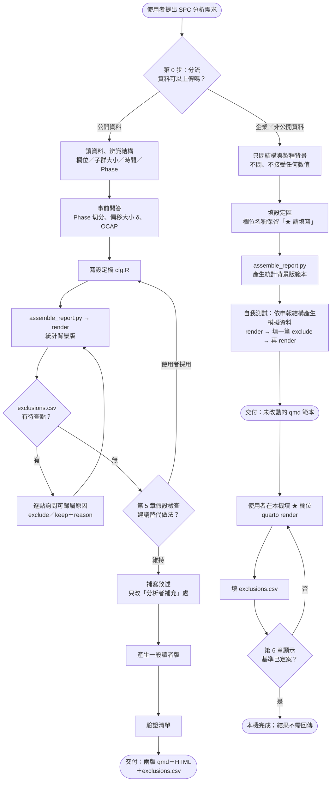
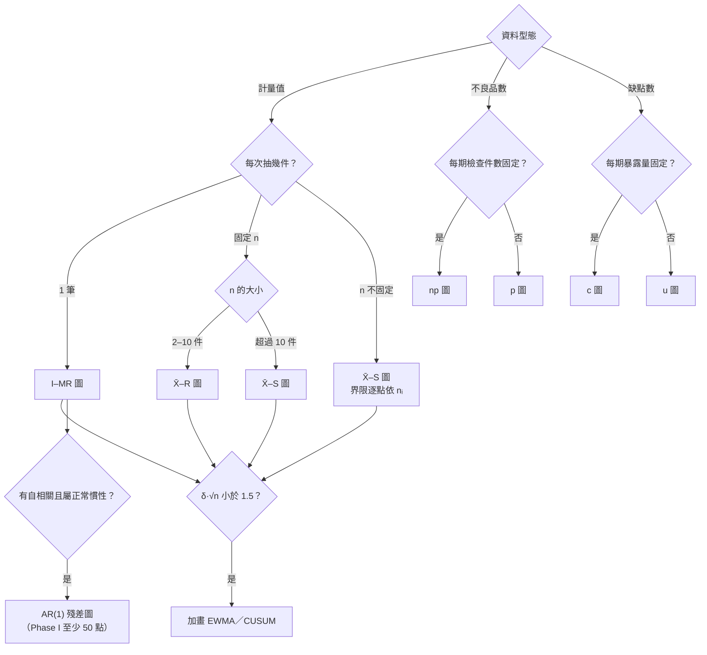
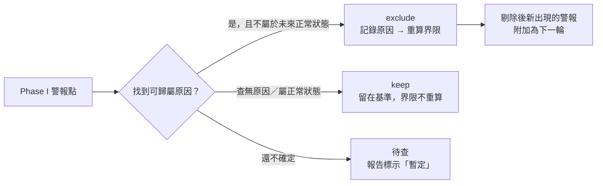

# spc-control-chart：SPC 統計製程管制圖分析 Skill

以**繁體中文**進行 SPC（Statistical Process Control，統計製程管制）管制圖分析的 Claude Skill。
依資料結構自動選圖、檢查假設、以 `exclusions.csv` 記錄 Phase I 失控原因，最後交付含逐段 R 程式碼的 Quarto（`.qmd`）與 HTML 報告。

- **支援圖型**：$\bar X$–$R$、$\bar X$–$S$、$I$–$\mathrm{MR}$、$p$、$np$、$c$、$u$、EWMA、CUSUM、自相關資料的 AR(1) 殘差圖
- **兩種報告**：統計背景版（公式、假設檢查、ARL 模擬、完整程式碼）與一般讀者版（白話、第一屏就看到答案）
- **兩條分支**：
  - **公開資料**：Claude 直接讀資料、畫圖、和使用者逐點確認失控原因，交付兩版報告
  - **企業／非公開資料**：Claude **不看任何數值**，只詢問資料結構與製程背景，產出可在使用者本機讀檔執行的 `.qmd` 範本

---

## 目錄

1. [檔案結構與用途](#檔案結構與用途)
2. [安裝與使用](#安裝與使用)
3. [分析流程圖](#分析流程圖)
4. [方法原則](#方法原則)
5. [範例分析](#範例分析)
6. [參考文獻](#參考文獻)
7. [AI 協作聲明](#ai-協作聲明)

---

## 檔案結構與用途

```text
.
├── README.md                              ← 本文件
├── spc-control-chart/                     ← Skill 本體（打包成 zip 即可安裝）
│   ├── SKILL.md                           ← Skill 入口：規則、分流、兩條分支的步驟、驗證清單
│   ├── assets/
│   │   ├── spc_functions.R                ← 共用 R 函式（計算用 base R，畫圖用 ggplot2），以 block 分段
│   │   ├── template_stat.qmd              ← 統計背景版報告範本（兩條分支共用）
│   │   ├── template_general.qmd           ← 一般讀者版報告範本（只用於公開資料分支）
│   │   └── config_private_template.R      ← 非公開資料分支的設定區範本（保留「★ 請填寫」）
│   ├── scripts/
│   │   └── assemble_report.py             ← 把設定檔與 R 函式段落插入範本，產生自成一體的 qmd
│   └── references/
│       ├── textbook.qmd                   ← 《SPC 管制圖技能教科書》：選圖表、假設檢查、公式、常見錯誤
│       ├── intake-questions.md            ← 事前問答腳本、問答與 cfg 的對應、隱私原則、失控點詢問方式
│       ├── config-reference.md            ← 全部 cfg 設定欄位與資料格式說明
│       ├── report-spec-statistical.md     ← 統計背景版報告規格（章節順序、寫作規則、交付前檢查）
│       └── report-spec-general.md         ← 一般讀者版報告規格（白話轉寫表、禁止事項）
└── examples/
    ├── public-viscosity/                  ← 範例 1：公開資料（飛機底漆黏度 I–MR 圖）
    │   ├── README.md                      ← 資料說明與問答紀錄
    │   ├── viscosity.csv                  ← 原始資料
    │   ├── report_stat.qmd／.html         ← 統計背景版報告
    │   ├── report_general.qmd／.html      ← 一般讀者版報告
    │   └── exclusions.csv                 ← Phase I 失控點調查紀錄
    └── private-bushing/                   ← 範例 2：非公開資料（鋼製軸套外徑 X̄–R 範本）
        ├── README.md                      ← 資料說明、埋入事件（答案卷）與問答紀錄
        ├── simulation data.csv            ← 自行產生的模擬資料
        ├── bushing_od_spc.qmd             ← Claude 交付的範本（★ 欄位已由使用者在本機填好）
        ├── bushing_od_spc.html            ← 本機第一次 render 的結果（基準暫定）
        └── exclusions.csv                 ← 第一次 render 產生的待查清單
```


### 各元件如何協作

| 元件 | 角色 |
|---|---|
| `SKILL.md` | 告訴 Claude 何時啟用、必須遵守的 8 條規則，以及每一步要做什麼 |
| `references/textbook.qmd` | 方法的唯一依據；與其他說明衝突時以教材為準 |
| `references/intake-questions.md` | 決定要問使用者什麼、每個答案寫進哪個 `cfg` 欄位 |
| `assets/spc_functions.R` | 讀檔（自動處理 UTF-8 BOM／Big5）、選圖、估計界限、WECO 判讀、假設檢查、EWMA／CUSUM、AR(1) 殘差、ARL 模擬、白話文字產生 |
| `scripts/assemble_report.py` | 範本中的 `# <<SPC:名稱>>` 換成對應 R 段落、`# <<SPC:config>>` 換成設定檔，產出**不需要另外 R 檔**的單一 qmd |
| `assets/template_*.qmd` | 報告骨架；分析者只在 `<!-- 分析者補充 -->` 處補寫，不改動自動產生的數字 |
| `exclusions.csv` | （執行時產生）Phase I 待查點的調查紀錄：輪次、規則、`exclude`／`keep`、原因 |

---

## 安裝與使用

### 安裝 Skill

1. 將 `spc-control-chart/` 資料夾打包成 zip：

   ```bash
   zip -r spc-control-chart.zip spc-control-chart
   ```

2. 在 Claude 中點 **＋** → **新增 skill**。
3. 選擇**上傳 zip**，選取 `spc-control-chart.zip`，完成後即可在對話中使用。

### 呼叫方式

```text
/spc-control-chart 幫我分析這筆資料
```

或直接描述需求，例如「我想看這條產線的不良率是否穩定」。提到管制圖、SPC、製程是否穩定、失控點、管制界限、品質監測、不良率監測時，Skill 會自動啟用。

### 執行環境

| 用途 | 需要 |
|---|---|
| 產生報告 | R（ggplot2、knitr、rmarkdown）、Quarto |
| 組合範本 | Python 3（只用標準函式庫） |
| 讀 Excel（選用） | R 套件 readxl |

> 非公開資料分支中，使用者只需在**自己的電腦**安裝 R 與 Quarto；render 時需連網一次，以把 MathJax 公式元件嵌入 HTML。

---

## 分析流程圖

### 整體流程



### 選圖邏輯（`chart = "auto"`）



> 也可在 `cfg$chart` 指定圖型；不符合資料結構時程式會停止並說明。各圖公式與常數見 `references/textbook.qmd`。

### Phase I 失控點處理



---

## 方法原則

以下 8 條規則出自教材，Skill 不可違反：

1. 界限只用 Phase I 中**未剔除**的點估計；Phase II 固定界限，不重估。
2. Phase I 只有在找到可歸屬原因、且不屬於未來基準機制時才剔除，並記錄原因；查無原因的點保留。**決定由使用者做**，Claude 不自行判定原因。
3. WECO 4 條規則只用於位置圖（$\bar X$、$I$、殘差圖）；$R$／$S$／$\mathrm{MR}$、計數圖、EWMA／CUSUM 只判斷是否超界。
4. 先看穩定性，再看分布；不為通過常態檢定任意轉換資料。偏態個別值依製程知識改用 lognormal，或在基準點數很多時用經驗分位數界限。
5. 計數圖：期望數小時用精確分位數界限；檢查過度／不足離散，不直接放寬界限。基準期零事件時停止。
6. 自相關個別值：先判斷是正常慣性還是可移除的異常；正常慣性才用 AR(1) 殘差圖。
7. 不做製程能力分析，不以規格界限代替管制界限。
8. 警報＝調查線索，不寫成原因已證實；沒有警報≠已證明穩定；預設 EWMA／CUSUM 參數不保證 $ARL_0 = 370$。

### 非公開資料的隱私原則

| 可以問 | 不問、也不接受 |
|---|---|
| 資料型態、子群大小、大約組數、欄位「種類」、檔案格式、Phase 切分方式、抽樣方式、變異來源類型、是否做過 MSA、OCAP 角色職稱、常見原因類型 | 任何量測值、平均值、標準差、規格上下限、既有管制界限、產品名稱或料號、客戶名稱、人名、實際欄位名稱、資料樣本列、執行後的結果或截圖 |

---

## 範例分析

兩個範例各對應一條分支，完整的資料說明與對話紀錄見附檔。

### 範例 1：公開資料 —— 飛機底漆黏度 I–MR 管制圖

📄 [`examples/public-viscosity/README.md`](examples/public-viscosity/README.md)

| 項目 | 內容 |
|---|---|
| 資料 | R 套件 qcc 內建資料集 `viscosity`（Montgomery, 2005），35 批、每批 1 個量測值 |
| Phase 切分 | `trial = TRUE` 第 1–20 批為基準期；`FALSE` 第 21–35 批為監測期 |
| 選圖 | 每批只有一筆 → I–MR 圖；使用者希望偵測約 0.5σ 偏移 → 加畫 EWMA／CUSUM |
| Phase I 決策 | 第 4 批（35.96）在 I 圖與 MR 圖都超出上界；使用者回覆查無原因 → **保留** |
| 假設檢查 | Shapiro–Wilk $p = 0.003$，但偏態主要來自第 4 批單一點；無自相關 → 使用者選擇**維持常態 3σ 界限**，報告註明限制 |
| 主要發現 | 中心線 34.09、I 圖界限 32.56–35.61。監測期無點超界，但第 25 批起連續 11 批在中心線之上（約 +1.2σ）；I 圖 WECO 規則於第 29 批、上側 CUSUM 於第 30 批、EWMA 於第 35 批發出警報 |
| 附檔 | [`viscosity.csv`](examples/public-viscosity/viscosity.csv)、[`report_stat.html`](examples/public-viscosity/report_stat.html)／[`.qmd`](examples/public-viscosity/report_stat.qmd)、[`report_general.html`](examples/public-viscosity/report_general.html)／[`.qmd`](examples/public-viscosity/report_general.qmd)、[`exclusions.csv`](examples/public-viscosity/exclusions.csv) |

**這個範例展示：** Claude 直接計算、逐點和使用者確認失控原因、假設檢查後讓使用者決定界限方法，以及三種方法對同一個小幅持續偏移的偵測時點差異。

<details>
<summary><b>使用者與 Claude 的問答紀錄</b>（點開查看）</summary>

**使用者：**

> @viscosity.csv /spc-control-chart 幫我分析這筆資料

**Claude：** 我先看一下分析流程需要確認的問題，然後一次問你。

**Claude 提問（3 題）：**

**Q1. 資料性質**：這份黏度資料（35 批，trial 欄 TRUE 20 批／FALSE 15 批）可以上傳讓我直接分析，還是屬於企業／非公開資料？
- 公開資料，直接分析 (Recommended)：看起來像 R qcc 套件的 viscosity 範例（Montgomery 教科書）；我直接算並交付報告
- 企業／非公開資料：我不使用數值，只產出你在本機執行的 qmd 範本

**Q2. Phase 切分**：我打算把 trial=TRUE 的 20 批當基準期（Phase I）建立界限、trial=FALSE 的 15 批當監測期（Phase II），每批 1 筆用個別值–移動全距（I–MR）圖。這樣切分對嗎？
- 對，TRUE=基準、FALSE=監測 (Recommended)
- 35 批全部當基準期

**Q3. 偏移大小**：想偵測多大的黏度均值偏移？（以製程標準差 σ 為單位；小偏移會加畫 EWMA／CUSUM）
- 不確定 (Recommended)：用預設設定，由報告說明
- 約 0.5σ
- 約 1σ
- 1.5σ 以上

**使用者回答：**
- Q1 → 公開資料，直接分析 (Recommended)
- Q2 → 對，TRUE=基準、FALSE=監測 (Recommended)
- Q3 → 約 0.5σ

**Claude：** Phase I 有一個警報點：第 4 批（35.96），在 I 圖與 MR 圖都超出上界。

**Claude 提問：**

**第 4 批**：Phase I 第 4 批（黏度 35.96，I 圖與 MR 圖都超出上界，偏高）：有沒有找到可歸屬原因？公開範例本身沒有記載這批的原因，決定由你做。
- 查無原因 → 保留：依教材規則，查無原因的點留在基準中，界限不重算
- 有原因且非正常狀態 → 剔除：請在備註寫原因（例如配方錯誤、量測失誤）；剔除後重算界限
- 還不確定，先標待查：報告會標示基準為「暫定」

**使用者回答：** 查無原因 → 保留

**Claude 提問：**

**界限方法**：假設檢查：Phase I 的 20 個黏度值偏離常態（Shapiro–Wilk p = 0.003，偏態 1.62），但這主要是第 4 批（35.96）單一點造成的；無自相關（lag-1 = 0.05）。報告建議可改用對數常態（lognormal）界限（20 點太少，經驗分位數不適用）。要採用嗎？
- 維持常態 3σ 界限 (Recommended)：偏態來自單一異常點而非分布本質，無製程知識支持對數常態；報告會標明此限制
- 改用 lognormal 界限：若你認為黏度本質上右偏（全為正值）

**使用者回答：** 維持常態 3σ 界限 (Recommended)

**Claude：**

兩份報告都做好了。主要發現是：大約從第 25 批起，黏度持續偏高。

**基準期（第 1–20 批）**
- 每批只有一個量測值，所以用 I–MR 圖（個別值圖＋相鄰兩批差距的移動全距圖）。
- 正常範圍：中心線 34.09，I 圖界限 32.56–35.61，MR 圖上界 1.87。
- 第 4 批（35.96）在 I 圖和 MR 圖都超出上界。依你的決定，查無原因所以保留在基準裡，已記錄在 `exclusions.csv`。
- 前 20 批的分布不對稱，但主要是第 4 批這一點造成的。依你的選擇維持一般的 3σ 界限（以標準差計），報告中有註明這個限制。資料沒有自相關（前後批之間沒有連帶關係）。

**監測期（第 21–35 批）**
- 沒有任何一批超出界限，MR 圖也沒有警報，表示批與批之間的波動沒有變大。
- 但第 25 批起連續 11 批都在中心線之上，平均約 34.71，比基準高約 1.2σ。
- 三種方法都偵測到同一方向的偏高：
  - I 圖從第 29 批開始出現「多點偏同一側」的警報，共 5 點。
  - 上側 CUSUM 在第 30 批發出警報。
  - EWMA 在第 35 批發出警報。
- 這看起來像是均值持續小幅往上移，而不是個別批次突然出錯。不過警報只是調查線索，原因還要到現場確認。

**限制**
保留第 4 批會讓界限稍微變寬，對小偏移的偵測比較保守。基準也只有 20 批。

**建議**
回查第 24、25 批前後有沒有換原料、改配方、調整設備或換量具。如果偏高是刻意的製程變更，應該用變更後的資料重新建立基準。

要交付的檔案：
- `report_stat.html`：統計背景版，含公式、假設檢查、EWMA／CUSUM 和完整 R 程式碼
- `report_general.html`：一般讀者版
- 兩份對應的 `.qmd`：可以重新 render
- `exclusions.csv`：Phase I 失控點調查紀錄

</details>

### 範例 2：非公開資料 —— 鋼製軸套外徑 X̄–R 管制圖範本

📄 [`examples/private-bushing/README.md`](examples/private-bushing/README.md)

| 項目 | 內容 |
|---|---|
| 資料 | 以亂數產生的**虛構資料**（225 列＝45 組 × 5 件），另附 Big5 版本測試自動改用 CP950 讀檔 |
| Claude 知道的 | 只有使用者口述的抽樣方式與欄位「種類」說明；**沒有讀取資料檔、沒有看到任何數值** |
| 事前問答 | 8 題：資料性質、偏移大小（1σ）、MSA（沒做過）、變異來源、資料格式、Phase 切分、OCAP 角色、常見原因 |
| 選圖 | n = 5 固定 → X̄–R 圖；$\delta\sqrt n = 2.24 \ge 1.5$ → 不另加 EWMA／CUSUM |
| Claude 交付 | `bushing_od_spc.qmd`（設定區保留 5 個「★ 請填寫」） |
| 本機使用 | 填欄名 → `quarto render` → 在 `exclusions.csv` 填 `exclude`／`keep` → 再 render 到第 6 章顯示「基準已定案」 |
| 附檔 | [`simulation data.csv`](examples/private-bushing/simulation%20data.csv)、[`bushing_od_spc.qmd`](examples/private-bushing/bushing_od_spc.qmd)（★ 已填）、[`bushing_od_spc.html`](examples/private-bushing/bushing_od_spc.html)、[`exclusions.csv`](examples/private-bushing/exclusions.csv) |
| 附檔狀態 | 本機**第一次 render** 的結果：$\bar{\bar X} = 25.0021$，與答案卷一致；第 7 組（R 圖）、第 12 組（$\bar X$ 圖）待查，基準標示為「暫定」。依「現場備註」在 `exclusions.csv` 填寫後再 render，即可完成剔除與界限重算 |
| 驗證方式 | 資料中埋入三個事件（量具未歸零、原料換批、更換刀具），README 附參考答案（摺疊），可比對範本在本機跑出的結果 |

**為什麼用模擬資料：** 公開資料集可能出現在模型的訓練資料中（範例 1 中 Claude 就從欄位與筆數認出了 qcc 的 `viscosity`），無法分辨範本是真的正確，還是 AI 早就知道答案。使用者自行產生、從未公開的資料，才能驗證「AI 沒看過資料也能做出正確範本」這個承諾。

<details>
<summary><b>使用者與 Claude 的問答紀錄</b>（點開查看）</summary>

**使用者：**

> /spc-control-chart 我想分析加工汽車零件的鋼製軸套資料。外徑是關鍵品質特性，每 2 小時在機台旁連續抽 5 件，用分厘卡量外徑。

**Claude 提問（4 題）：**

**Q1. 資料性質**：這份鋼製軸套外徑資料可以上傳讓我直接分析，還是屬於企業／非公開資料？（非公開時我不看任何數值，只依結構做一份你在自己電腦上執行的 Quarto 範本）
- 可以上傳分析：我直接讀資料、畫管制圖、和你逐點確認失控原因，交付兩版報告
- 企業／非公開資料：只問結構與製程背景，產出本機執行的 qmd 範本

**Q2. 偵測偏移**：希望管制圖能及早抓到多大的外徑平均值偏移？（以製程標準差 σ 為單位）
- 約 1σ：中等偏移；n=5 時 X̄ 圖已足夠敏感
- 約 0.5σ：小偏移（例如刀具緩慢磨耗）；會加畫 EWMA／CUSUM
- 1.5σ 以上
- 不確定

**Q3. 量測系統**：分厘卡的量測系統做過 MSA（例如 Gage R&R）嗎？
- 做過／沒做過／解析度可能不足

**Q4. 變異來源**（可複選）：刀具磨耗／換刀、班別／操作員、原料批次、機台

**使用者回答：**
- Q1 → 企業／非公開資料
- Q2 → 約 1σ
- Q3 → 沒做過
- Q4 → 未選

**Claude 提問（4 題）：**

**Q5. 資料格式**：資料檔是怎麼排的？（只需告訴我格式，不需要貼任何內容）
- 一列一件（長格式）／一列一組（寬格式）／不確定

**Q6. Phase 切分**：大約有幾組可當基準的資料？以後要監測的資料怎麼提供？
- 約 25 組，全部先當基準／同一檔案前後切分／同一檔案有欄位標記階段／分成兩個檔案

**Q7. OCAP 角色**：外徑失控時，現場是誰處理？（只需職稱）
- 操作員／品管／課長
- 操作員／製程工程師／品保主管
- 先保留空白

**Q8. 常見原因**（可複選，用於 OCAP 檢查清單）：刀具磨耗／崩刃、刀具補償／換刀調整、熱變形（暖機、切削液溫度）、分厘卡校正／量測手法

**使用者回答：**
- Q5 → 我貼欄位說明
- Q6 → 約 25 組，全部先當基準
- Q7 → 操作員／品管／課長
- Q8 → 四項全選

**Claude：** 請貼上欄位說明，只要說明欄位的種類和排列方式，不需要真實欄位名稱或任何數字；請不要貼量測值、規格、既有管制界限、料號或資料列。

**使用者：** 貼上欄位說明（附檔「3. 欄位說明」表格的前三欄：欄位、型態、意義，不含設定區對應）。欄位說明顯示資料有「階段」欄位（第 1–25 組為 I、第 26–45 組為 II），所以 Phase 切分改為依欄位標記。

**Claude 的處理：**

1. **填設定區**：依問答結果設定資料型態（計量值）、每組 5 件、基準期約 25 組、偵測偏移 1σ、連續抽樣、班別為變異來源但子群內未混班、未做 MSA、抽樣間隔每 2 小時，以及 OCAP 角色與四類常見原因。
2. **欄位名稱不寫入範本**：雖然使用者貼了欄位說明，範本中的資料檔路徑與四個欄名（取樣時間、子群編號、外徑、階段）仍保留為「★ 請填寫」，由使用者在本機自行填寫。
3. **小偏移圖**：偏移 1σ 換算到 5 件平均值約為 2.24 個標準差（≥ 1.5），X̄ 圖已有合理偵測力，所以範本不另加 EWMA／CUSUM。
4. **組合範本**：產生統計背景版 `bushing_od_spc.qmd`，所有 R 程式碼都在報告各段落中，不需要另外的 R 檔。

#### 在本機使用範本

1. 安裝 R（含 ggplot2、knitr、rmarkdown 套件）與 Quarto。
2. 把 `bushing_od_spc.qmd` 和資料檔放在同一個資料夾，填好設定區 5 個「★ 請填寫」：資料檔路徑、取樣時間、子群編號、外徑、階段的欄名。
3. 執行 `quarto render bushing_od_spc.qmd`。
4. 打開產生的 `exclusions.csv`，每個待查點填 `exclude`（找到原因，而且不屬於以後的正常狀態）或 `keep`（查無原因或屬正常狀態），並在 `reason` 寫原因。「現場備註」欄可作為查原因的線索；查無原因的點要保留。
5. 再 render，重複到第 6 章顯示「基準已定案」。

產生 HTML 時需要連網一次，以便把數學公式顯示元件嵌入檔案。結果不需要傳回給 Claude。

要交付的檔案：
- `bushing_od_spc.qmd`：統計背景版範本（設定區保留 ★，含完整 R 程式碼）

</details>

---

## 參考文獻

### 方法主軸

1. Zwetsloot, I. M., Jones-Farmer, L. A., & Woodall, W. H. (2024). Monitoring univariate processes using control charts: Some practical issues and advice. *Quality Engineering, 36*(3), 487–499. <https://doi.org/10.1080/08982112.2023.2238049>
2. Jones-Farmer, L. A., Woodall, W. H., Steiner, S. H., & Champ, C. W. (2014). An overview of Phase I analysis for process improvement and monitoring. *Journal of Quality Technology, 46*(3), 265–280. <https://doi.org/10.1080/00224065.2014.11917969>
3. Jensen, W. A., Jones-Farmer, L. A., Champ, C. W., & Woodall, W. H. (2006). Effects of parameter estimation on control chart properties: A literature review. *Journal of Quality Technology, 38*(4), 349–364. <https://doi.org/10.1080/00224065.2006.11918623>
4. Lucas, J. M., & Saccucci, M. S. (1990). Exponentially weighted moving average control schemes: Properties and enhancements. *Technometrics, 32*(1), 1–12. <https://doi.org/10.1080/00401706.1990.10484583>
5. Page, E. S. (1954). Continuous inspection schemes. *Biometrika, 41*(1/2), 100–115. <https://doi.org/10.1093/biomet/41.1-2.100>
6. Alwan, L. C., & Roberts, H. V. (1988). Time-series modeling for statistical process control. *Journal of Business & Economic Statistics, 6*(1), 87–95. <https://doi.org/10.1080/07350015.1988.10509640>

### 公式與軟體文件

7. NIST/SEMATECH. *e-Handbook of Statistical Methods*, §6.3.2.1, Shewhart X-bar and R and S Control Charts. <https://www.itl.nist.gov/div898/handbook/pmc/section3/pmc321.htm>
8. NIST/SEMATECH. *e-Handbook of Statistical Methods*, §6.3.2.2, Individuals Control Charts. <https://www.itl.nist.gov/div898/handbook/pmc/section3/pmc322.htm>
9. NIST/SEMATECH. *e-Handbook of Statistical Methods*, §6.3.3.1, Counts Control Charts. <https://www.itl.nist.gov/div898/handbook/pmc/section3/pmc331.htm>
10. NIST/SEMATECH. *e-Handbook of Statistical Methods*, §6.3.3.2, Proportions Control Charts. <https://www.itl.nist.gov/div898/handbook/pmc/section3/pmc332.htm>
11. NIST. *Dataplot Reference Manual*, U Control Chart. <https://www.itl.nist.gov/div898/software/dataplot/refman1/ch2/ucontrol.pdf>
12. NIST/SEMATECH. *e-Handbook of Statistical Methods*, §6.3.2, What are Variables Control Charts?（WECO 與趨勢規則）<https://www.itl.nist.gov/div898/handbook/pmc/section3/pmc32.htm>
13. NIST/SEMATECH. *e-Handbook of Statistical Methods*, §6.3.1.3–6.3.1.4, CUSUM 與 EWMA. <https://www.itl.nist.gov/div898/handbook/pmc/section3/pmc313.htm>、<https://www.itl.nist.gov/div898/handbook/pmc/section3/pmc314.htm>
14. R Core Team. *R stats package documentation*（`arima`、`acf`、`Box.test`、`qbinom`、`qpois` 等）. <https://stat.ethz.ch/CRAN/doc/manuals/r-release/packages/stats/refman/stats.html>

### 範例資料

15. Montgomery, D. C. (2005). *Introduction to Statistical Quality Control* (5th ed.). New York: John Wiley & Sons, pp. 232–235.
16. Scrucca, L. *qcc: Quality Control Charts*（R 套件），資料集 `viscosity`. <https://luca-scr.github.io/qcc/reference/viscosity.html>

網頁查閱日：2026-11-16。參考文獻以原始論文卷期年為準。

---

## AI 協作聲明

本 Skill（含 `SKILL.md`、R 函式、報告範本、組合腳本、參考說明文件、教材整理與本 README）由使用者提供需求、報告規格與參考文獻，並透過生成式 AI（Anthropic Claude）協作完成程式撰寫、內容整理、文字編修、專有名詞統一與公式 LaTeX 格式調整。範例中的對話紀錄為使用者與 Claude 的實際互動。

- **AI 的角色**：AI 為輔助工具，不列為作者，亦不作為學術論述或公式正確性的證據。
- **可能的錯誤**：AI 協作產生或修訂的內容仍可能包含錯誤、遺漏或不精確之處；使用者及後續編修者應依原始文獻與官方文件核對論述、公式、引用及程式結果。
- **驗證範圍**：本 Skill 以兩個範例（公開資料、自行產生的模擬資料）測試過流程；這不代表已完成逐項文獻查證、所有資料情境的程式驗證或專家審查。
- **責任歸屬**：實際用於教學、研究或製程決策前，應完成相應查核，並由使用者及採用者負責最終內容與應用判斷。管制圖警報是調查線索，不能取代現場專業判斷。
- **著作權**：所列參考文獻為內容依據，AI 協作不改變原始文獻的著作權與引用要求。
